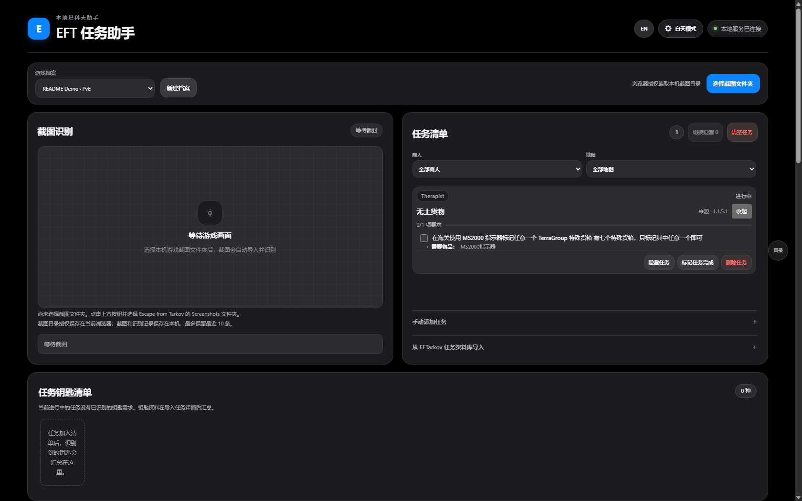
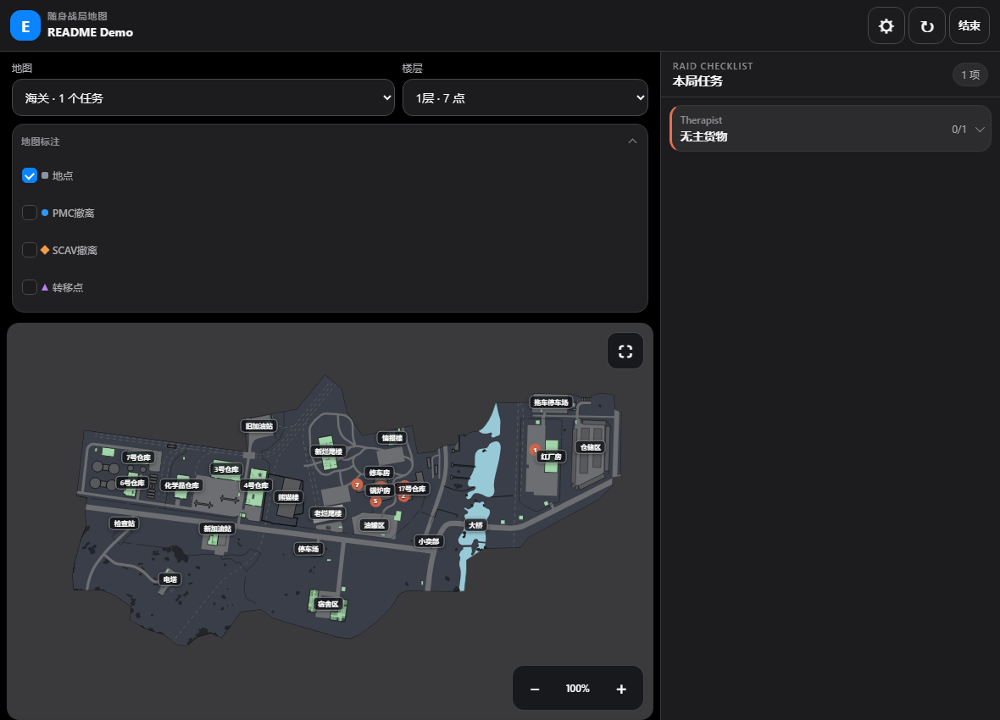
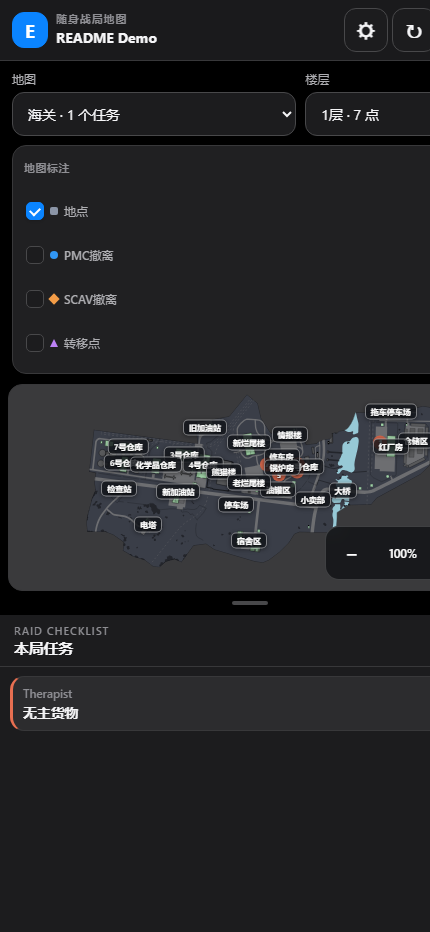

# EFT Task Assistant

**A quest, map, and Hideout planning companion for Escape from Tarkov.** Recognize trader quests from screenshots, track each objective, plan quest keys and Hideout materials, and view quest locations on maps.

[简体中文](README.md) · [Windows releases](https://github.com/xxtra1112/eft-task-assistant/releases) · [Report a problem](https://github.com/xxtra1112/eft-task-assistant/issues)

> This is a community-made tool. It is not affiliated with Battlestate Games and is not an official client or data service. Always verify requirements in the game.

## Contents

- [Features](#features)
- [Screenshots](#screenshots)
- [Install and run](#install-and-run)
- [First-time setup](#first-time-setup)
- [Screenshot recognition](#screenshot-recognition)
- [Quest list and maps](#quest-list-and-maps)
- [Hideout planning](#hideout-planning)
- [Mobile LAN access and privacy](#mobile-lan-access-and-privacy)
- [Back up your data](#back-up-your-data)
- [Troubleshooting](#troubleshooting)
- [Development and build](#development-and-build)
- [Continuous integration and releases](#continuous-integration-and-releases)
- [Data sources and license](#data-sources-and-license)

## Features

- **Screenshot recognition:** Import screenshots from a folder you authorize, identify trader quest lists, and match quests. Matched quests are added to your list automatically, with a record of what was recognized.
- **Quest tracking:** Filter by trader or map, check off individual objectives or track item counts, collapse quest cards, toggle hidden quests, add or remove quests manually, and undo recent actions.
- **Key checklist:** Summarize keys required by tracked quests, see which quests need them, and review prompts when new keys appear.
- **Quest maps:** View objectives, source images, and location notes. Switch map backgrounds by floor, zoom and pan, mark points as visited, and draw routes. Changing floors only changes the background; markers for all floors remain visible.
- **Mobile companion map:** Generate a one-time pairing QR code on the computer to view the map, markers, and current profile's quests on a phone. The phone has read-only access.
- **Hideout planning:** Select stations and target levels, include prerequisite stations automatically, and total required materials while tracking what you already own.
- **Local profiles:** No account or sign-in. Enter a profile name on first launch (PvE by default); profiles and game data stay on that computer. Each player runs the complete app on their own computer.

## Screenshots

These captures use an isolated demo profile and do not include anyone's local save or game screenshots. Quest catalogs, map data, extracts, and quest coordinates come from the [Tarkov.dev JSON API](https://json.tarkov.dev/endpoints); interactive-map configuration and SVG basemaps use public Tarkov.dev community map resources and may change upstream. The screenshots show the Chinese interface; use the in-app **EN** button to switch to English.

*Desktop: screenshot recognition, trader and map filters, and quest objective progress.*

*Tablet: map and current-raid quest list side by side, with task-specific markers.*

*Phone: portrait map view with a collapsible current-raid task panel.*

## Install and run

### Windows executable

Download and run `EFTTaskAssistant-vVERSION-Windows-x64.exe` from [GitHub Releases](https://github.com/xxtra1112/eft-task-assistant/releases).

The app starts a local web server and attempts to open your browser. The desktop server binds only to `127.0.0.1`, so other computers cannot access the desktop management interface. Enter a profile name on first launch; each computer keeps its own data.

The default address is `http://127.0.0.1:8765/`. If the port is busy, the app tries ports `8766` through `8785`; use the address and port printed in the launch window. Keep that window open while using the app. Closing it stops the service. The prebuilt executable does not require Python or Conda.

Published executables are not code-signed, so Windows may show an unknown-publisher warning. Download them only from this project's Releases page.

### Run from source

You need Windows, [Conda](https://docs.conda.io/projects/conda/en/latest/user-guide/install/index.html), and Python 3.11. In PowerShell, run:

~~~powershell
git clone https://github.com/xxtra1112/eft-task-assistant.git
cd eft-task-assistant
conda create -n eft-task-assistant python=3.11 pip
conda activate eft-task-assistant
python -m pip install -r requirements.txt
python main.py
~~~

Internet access is needed for the initial dependency installation and online catalog sync. Keep the terminal open while the service is running; press `Ctrl+C` to stop it.

## First-time setup

1. **Create a profile.** Enter a profile name on first launch to get started; the initial profile defaults to PvE. You can later create additional profiles for PvE, regular PvP, or season PvP saves.
2. **Load quest data.** Expand **Quest List → Tarkov.dev JSON API** and select **Sync public catalog**. Once synced, search, preview, and import quests. Online data may change or be temporarily unavailable.
3. **Choose your screenshot folder.** Select **Choose screenshot folder**, choose the game's actual `Screenshots` directory on this computer, and grant the browser permission when prompted.
4. **Start planning.** Review the quest list, filter by map, check your keys, and choose Hideout stations and target levels.

## Screenshot recognition

The app reads screenshots from the folder selected in the **browser's device**. It does not guess or read a hard-coded Windows user path. Choose the `Screenshots` folder used by your Escape from Tarkov installation. Supported image formats are PNG, JPG/JPEG, and WebP.

For local use at `127.0.0.1`, the latest Chrome or Edge is recommended. The screenshot folder is authorized and read by the browser on the computer running the app. Other computers do not access the desktop interface or monitor/read its screenshots.

Recognition results list the quests matched in each screenshot. Matched quests are automatically added to the selected profile. OCR runs locally on the computer hosting the assistant; screenshots are not sent to a cloud AI model. Recognition can be affected by the game language, screenshot crop, resolution, and interface changes, so review the results.

**A quest missing from a screenshot is not considered complete.** Quests are never automatically completed or removed just because they are absent from an image. Manage them manually in the quest list. Search the public catalog or add a quest manually if recognition misses it.

## Quest list and maps

- Each quest objective can be checked off individually. Use a counter for objectives requiring multiple items. A quest is completed automatically when all required objectives are complete.
- Filter the list by trader or map. The quest list and map stay in sync when you change the map filter.
- Collapsing a quest saves space. Hidden quests remain in the profile and can be shown with **Toggle hidden**. Clearing the quest list removes quests from the current profile, so use it carefully.
- The map's side panel groups locations and objectives by quest. Select a marker to view its location details; right-click a marker to toggle its visited status. Maps support zoom, pan, fullscreen, and route drawing.
- Map backgrounds and location data come from public sources and may be incomplete or differ from the current game version. Verify destinations and required items before a raid.

## Hideout planning

In **Upgrade Targets**, select Hideout stations and target levels. A target may be the station's current level. Prerequisite stations are selected automatically. **Upgrade Materials** totals the requirements for the selected plan and lets you enter owned quantities to see what's still missing. Roubles and euros are excluded from the item count.

**Reset levels** clears station selections and target levels. **Reset owned quantities** clears the material counts you entered. These actions are separate.

## Mobile LAN access and privacy

The desktop app is local to one computer. Each player runs the complete executable on their own computer and names a local profile; no account or password is used. The desktop page and management API bind only to `127.0.0.1`. The app starts a separate LAN endpoint for the phone map; paired phones can only read maps and the active profile's quests, not change quests, progress, or markers.

Connect the phone and computer to the same trusted LAN. On the computer, open **Quest Map**, choose **Mobile Map QR**, and scan the code. No account, password, or certificate download is needed. Each QR code expires after two minutes and works once; a paired phone receives restricted read-only access. Closing the desktop dialog revokes an unused code, and the phone can end its access. Do not share the QR code or paired phone page with anyone you do not trust, and never forward the phone service port to the public internet.

If the phone cannot connect, confirm both devices are on the same LAN and allow the app through Windows Firewall on **Private networks** only; do not allow it on public networks. Use `ipconfig` to find the computer's LAN IPv4 address. The desktop port starts at `8765`; the phone read-only service starts at `8766`. If a port is busy, the app tries the following ports automatically.

Quests, profiles, and screenshot-recognition records stay on the computer running the app. Screenshot-folder permission stays in that computer's browser, and screenshots are recognized locally; up to 10 recent records are retained. The phone only reads the host computer's current profile data and never writes progress or visited-marker state back.

Hideout upgrade targets, owned material counts, quest and key visibility settings, map route drawings, and other interface preferences are stored in the local browser storage and scoped to the profile. They do not sync to other browsers or devices and are not included in the app data-folder backup below. Clearing browser site data may erase them.

Screenshots are not sent to cloud AI. Quest, map, and Hideout sync use the [Tarkov.dev JSON API](https://json.tarkov.dev/endpoints) and public Tarkov.dev map resources. Waypoint photo supplements and their verification read public EFTarkov map pages. If an item image cannot load from its primary host, the browser retries the same public image through [wsrv.nl](https://wsrv.nl/); no profile data, screenshots, or quest list is sent.

## Back up your data

By default, app data is stored in `%LOCALAPPDATA%/EFTTaskAssistant`. It includes quests, profiles, and recognition records for this computer. To back up or move your data:

1. Close the app and make sure the service has stopped.
2. Copy the entire `EFTTaskAssistant` folder to a safe location.
3. To restore it, put the folder back in the same data directory and restart the app.

Do not copy SQLite database files while the service is running; the backup may be incomplete. Backups may contain personal screenshots and game history, so keep them private.

## Troubleshooting

**The page did not open.** Make sure the launch window is still running and manually open the `127.0.0.1` address printed there. If the default port was busy, use the next port shown in the window.

**Screenshots are not imported or monitored.** In Chrome or Edge, select the screenshot folder again and grant access. Check that you selected the actual folder and that the files use a supported image format.

**A quest was missed or matched incorrectly.** Check that the screenshot shows the full trader quest list and that the game language matches the available data. Sync the public quest catalog, then search for or manually add the quest. Always review recognition results.

**Quest or map data will not load.** Public data sync requires internet access. If a source website changes or is temporarily unavailable, try again later. Previously downloaded and cached data may still be available.

**The phone QR code does not open or has expired.** Confirm the phone and computer use the same trusted LAN, allow the app through Windows Firewall on Private networks, and generate a fresh code. No environment variable or certificate is required; a QR code expires after two minutes and works once.

If the problem persists, report it on [GitHub Issues](https://github.com/xxtra1112/eft-task-assistant/issues). Before sharing diagnostics, remove usernames, screenshots, and other personal information.

## Development and build

To build a single-file Windows x64 executable, activate a Conda environment with the app dependencies installed, then run:

~~~powershell
python -m pip install -r requirements-build.txt
& "$PWD/build_windows.ps1" -Version 1.2.0
~~~

The executable is written to the `dist` directory. Building requires Windows x64, Python 3.11, and internet access to install and bundle the OCR runtime dependencies. Bug reports and improvement suggestions are welcome on GitHub Issues.

## Continuous integration and releases

GitHub Actions checks Python dependencies and imports, Python compilation, and frontend JavaScript syntax on pushes to `main`, pull requests, and manual runs. Pushing a new `vMAJOR.MINOR.PATCH` tag reads its matching bilingual release notes from `docs/releases/`, builds and starts the Windows executable, checks for an HTTP 200 response, then creates a GitHub Release with the executable, license, third-party notices, and SHA-256 checksum.

## Data sources and license

Waypoint photos are supplemented from public EFTarkov (`www.eftarkov.com`) map pages. Initial reviewed coverage is limited to two PvE Factory waypoints (Postman Pat Part 1 and Delivery from the Past), with four location photos; this is not a complete restoration. Records bind the exact task, map, current waypoint ID, floor and coordinates and recheck the legacy marker and photo URLs. Unverified points and other game modes remain without photos. Task covers, item artwork and map backgrounds are not substituted for location photos. Cached details are enriched on read without resetting tasks or visits. Source failures leave tasks/maps available, and failed images show a message. Photo source pages are linked in details; third-party photos are not licensed under this project's MIT license.

Quest catalogs, objectives, key requirements, acquisition methods, map objects, and extracts/transits come from the [Tarkov.dev JSON API](https://json.tarkov.dev/endpoints). Quest coordinates use the `zones` and `possibleLocations` fields in quest details. Interactive-map configuration and SVG basemaps come from the [Tarkov.dev map project](https://github.com/the-hideout/tarkov-dev) and its [map-art repository](https://github.com/the-hideout/tarkov-dev-svg-maps), with map authors credited in the interface. The SVG map artwork is licensed under [CC BY-NC-SA 4.0](https://creativecommons.org/licenses/by-nc-sa/4.0/); this is separate from the MIT license for this project's original code and does not relicense map assets as MIT. Hideout data also uses Tarkov.dev. These are community sources, not official BSG APIs; the quest API does not label exact game-patch coverage, and data may be outdated, incomplete, or differ by game mode. Verify requirements in game. The app does not guess key acquisition methods or point locations when reliable source data is unavailable.

Original code in this project is available under the [MIT License](LICENSE). See [THIRD_PARTY_NOTICES.md](THIRD_PARTY_NOTICES.md) for the open-source components bundled in the Windows executable. Game trademarks and third-party content are not relicensed by this project.

For isolated automation, use `EFTTaskAssistant.exe --port 18765 --mobile-port 18766 --no-browser`. An occupied explicit port fails rather than falling back to another instance. Default startup behavior is unchanged.
